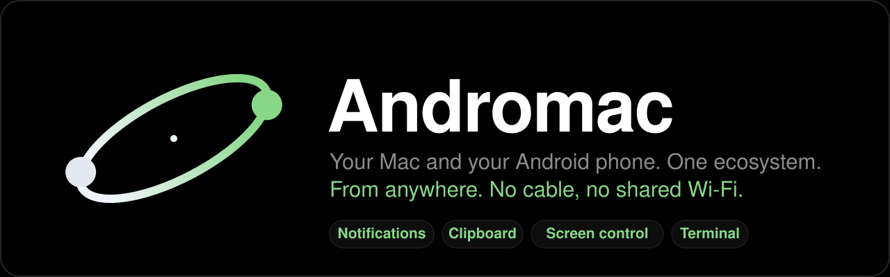
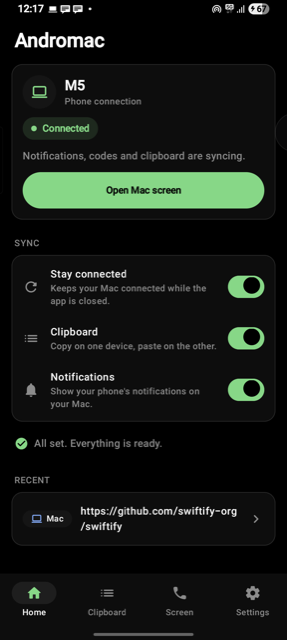
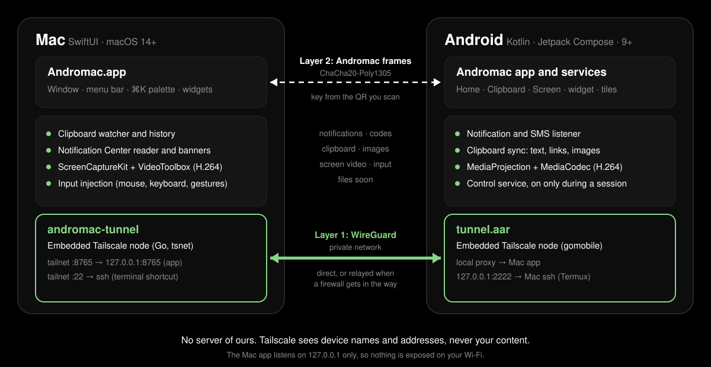

<div align="center">



<br/>

**Notifications · one-time codes · clipboard with images · screen view and control in both directions · terminal shortcuts**
between a Mac and an Android phone, over a private network that is **built in**. No cable. No shared Wi-Fi. No separate Tailscale app.

<br/>

[](../../releases/latest)


[Features](#-features) · [Screenshots](#-screenshots) · [Install](#-install-in-5-minutes) · [How it works](#-how-it-works) · [Security](#-security-and-privacy) · [Build](#-build-from-source) · [Roadmap](#-roadmap)

</div>

<br/>

## ✨ What it feels like

You get a text on your phone while you are typing on your Mac. The message appears on the Mac with the **real app's icon**. You type a reply right there and it goes out from your phone. The code from your bank lands in your Mac clipboard before you reach for the phone. You copy a screenshot on the Mac and paste it on the phone. Your phone dies in the other room? Open it on your Mac and control it with the trackpad.

Apple's Continuity does this for iPhones. **Andromac does it for Android**, and it keeps working when you are not on the same Wi-Fi.

## 🚀 Features

<table>
<tr>
<td width="50%" valign="top">

### 🔔 Notifications, both ways
Phone notifications show on the Mac with the app's real name and icon. **Reply** from the Mac, or **click to open that exact conversation on the phone**. Mac notifications appear on the phone too. Duplicates are removed, and apps already open on the Mac (WhatsApp, Telegram…) are not shown twice.

</td>
<td width="50%" valign="top">

### 🔑 One-time codes, instantly
Codes from SMS and notifications are detected and copied to your Mac clipboard the moment they arrive.

### 📋 A clipboard that follows you
Text, links and **images**. Each device keeps a searchable history of 100 items and the two histories are swapped every time they connect, even for things copied while offline.

</td>
</tr>
<tr>
<td width="50%" valign="top">

### 🖥️ Your phone, on your Mac
A resizable window shaped like the phone. Trackpad gestures just work: **two-finger scroll**, **pinch**, **three-finger drag**, rotate. Back, Home, Recents, Notifications, Lock, volume and screenshot are in the toolbar.

</td>
<td width="50%" valign="top">

### 💻 Your Mac, on your phone
A real touchpad: move, tap, **two-finger scroll**, pinch, **three-finger drag**, **four-finger swipes** for Spaces and Mission Control, and a Mac keyboard row with ⌘ and ⌥. You approve every session.

</td>
</tr>
<tr>
<td width="50%" valign="top">

### 📁 Your phone as a drive
Turn on sharing on the phone and your **internal storage and SD card appear in Finder** as a drive named *Phone*, from anywhere. Read-only by default, with a switch for read and write. Protected by the key from your QR pairing.

### 🌐 Its own private network
[Tailscale's `tsnet`](https://tailscale.com/kb/1244/tsnet) is embedded in both apps. Sign in once with a free Tailscale account. Sessions survive Wi-Fi to mobile-data switches, sleep and reboots, and reconnect on their own.

</td>
<td width="50%" valign="top">

### 💻 Terminal shortcuts
`ssh m5` from Termux reaches your Mac. `ssh f14` from the Mac reaches your phone. Through Andromac, with no VPN app on the phone.

</td>
</tr>
<tr>
<td width="50%" valign="top">

### 🧩 Always there, never in the way
Runs as a background service on both devices. A master switch, **Reconnect** and **Disconnect** buttons, a menu bar app, **⌘K** command palette, Android home-screen widget, Quick Settings tiles and notification buttons.

</td>
<td width="50%" valign="top">

### 🛡️ Friendly to payment apps
Android's accessibility service is switched on **only while you control the phone**, and Andromac asks for no overlay permission, so Paytm and banking apps keep working.

</td>
</tr>
</table>

## 📸 Screenshots

<div align="center">

<br/><br/>

&nbsp;&nbsp;&nbsp;

</div>

## 📦 Install in 5 minutes

1. **Mac:** download `Andromac-x.y.z.dmg` from [Releases](../../releases/latest) and drag *Andromac* to Applications.
   The app isn't notarized by Apple yet, so macOS may say it is "damaged" or from an unidentified developer. It isn't: macOS just tags every download from the internet. Clear the tag once, in Terminal, after copying the app to Applications:

   ```sh
   xattr -dr com.apple.quarantine /Applications/Andromac.app
   ```

   Then open it normally. (Alternative: right-click the app, choose **Open**, then **Open** again. On macOS 15 and later you may instead need *System Settings → Privacy & Security → Open Anyway*.)
2. **Android:** download `Andromac-x.y.z.apk` and install it. Play Protect may warn about a sideloaded app that reads notifications: choose *More details → Install anyway*.
3. **Sign in** to the built-in private network on both devices, with the same free Tailscale account.
4. **Scan the QR code** shown on the Mac with the phone.
5. Follow the **Setup** card. Every *Set up* button opens a guide that names exactly which app to allow, and where.
6. Close the windows. Andromac keeps running in the background.

<details>
<summary><b>🎮 Controlling the phone from the Mac (and keeping payment apps happy)</b></summary>

<br/>

Controlling the phone needs Android's accessibility service. Payment apps such as Paytm refuse to run while such a service is on, so Andromac keeps it **off** and uses it only during a session.

- Turn Andromac on in *Settings → Accessibility → Installed apps* when you want control. Andromac turns itself off again when the session ends.
- Power users: run `adb shell pm grant app.andromac android.permission.WRITE_SECURE_SETTINGS` once and Andromac switches it on and off by itself.
- Viewing screens, clipboard, notifications, terminal shortcuts and widgets need none of this.

</details>

<details>
<summary><b>💻 Terminal shortcuts</b></summary>

<br/>

Turn on *Remote Login* on the Mac (System Settings → General → Sharing), keep *Terminal access* on in Andromac, then add this to `~/.ssh/config` in Termux:

```
Host m5
  HostName 127.0.0.1
  Port 2222
  User <your Mac username>
  ServerAliveInterval 15
```

and run `ssh m5`. For the other direction, run `sshd` in Termux and connect to `127.0.0.1` port `2223` from the Mac.

</details>

## 🧠 How it works

<div align="center">

</div>

- **Layer 1, the network.** Each app embeds a Tailscale node, so your phone and Mac find each other from anywhere. Traffic goes direct when it can and through a relay when a firewall gets in the way.
- **Layer 2, Andromac.** Everything inside that tunnel is wrapped again in Andromac's own authenticated frames: ChaCha20-Poly1305, with a key derived from the QR code you scanned, and replay protection.
- **Video** is H.264 (VideoToolbox on the Mac, MediaCodec on Android) with adaptive bitrate and keyframe recovery for smooth control.
- The wire format is documented in [`docs/PROTOCOL.md`](docs/PROTOCOL.md), so other platforms can join.

## 🔒 Security and privacy

- **No server of ours.** No accounts, no analytics. Tailscale's coordination service sees device names and addresses, never your content, and log upload is switched off.
- **Two encryption layers**, with the Mac app listening on `127.0.0.1` only: nothing is exposed on your Wi-Fi.
- **You stay in control.** Every screen session needs approval on the device being shared. A master switch turns the connection off completely.
- **Clipboard:** items marked secret by password managers are never recorded or synced. History is stored only on your two devices, and *Clear* deletes it.
- Details: [`PRIVACY.md`](PRIVACY.md).

## 🛠️ Build from source

Needs Xcode 15+, JDK 17, the Android SDK and NDK, and Go.

```bash
# 1. the embedded network node
cd tunnel
go build -o build/andromac-tunnel ./cmd/andromac-tunnel                       # Mac helper
gomobile bind -target=android/arm64 -androidapi 28 -javapkg=app.andromac \
  -o build/tunnel.aar ./mobile && cp build/tunnel.aar ../android/app/libs/    # Android library

# 2. the Mac app
cd ../mac && ./build-app.sh --install        # build, sign and install /Applications/Andromac.app
./make-dmg.sh                                # optional: the styled installer

# 3. the Android app
cd ../android && ./gradlew assembleDebug
```

| Folder | What is in it |
|---|---|
| [`mac/`](mac) | SwiftUI app, widgets, DMG scripts |
| [`android/`](android) | Jetpack Compose app, services, widget and tiles |
| [`tunnel/`](tunnel) | Go: the embedded Tailscale node for both apps |
| [`docs/`](docs) | Protocol, notes, release checklist |
| [`branding/`](branding) | Logo |

## 🧭 Honest notes

Andromac is young. One person builds and tests it, on a Samsung Galaxy M14 (Android 15) and macOS 27.

- Android hides the clipboard from background apps, so phone → Mac clipboard syncs what the system allows; Mac → phone is fully automatic.
- macOS always shows the sending app's icon (Andromac) on the left of native notifications. Andromac attaches the real app icon as a thumbnail, and can draw its own banners instead.
- The Mac widgets and a smooth installer need an Apple Developer ID. See [`mac/Widgets/README.md`](mac/Widgets/README.md) and [`docs/PUBLIC_RELEASE_CHECKLIST.md`](docs/PUBLIC_RELEASE_CHECKLIST.md).

## 🗺️ Roadmap

- [ ] Phone fingerprint unlocks the Mac; Touch ID as a gate for phone control
- [ ] Notarized Mac build and the Control Center widget
- [ ] File drag and drop between the devices
- [ ] Reply to SMS and see calls on the Mac

## 🤝 Contributing

Issues and pull requests are welcome. If you build a client for another platform, the [protocol](docs/PROTOCOL.md) is all you need.

---

<div align="center">

**Made with ♥ by [Abhishek Roy](https://github.com/the-abhishekroy)**

<sub>Android and Mac are trademarks of their respective owners. Andromac is an independent project.</sub>

</div>
