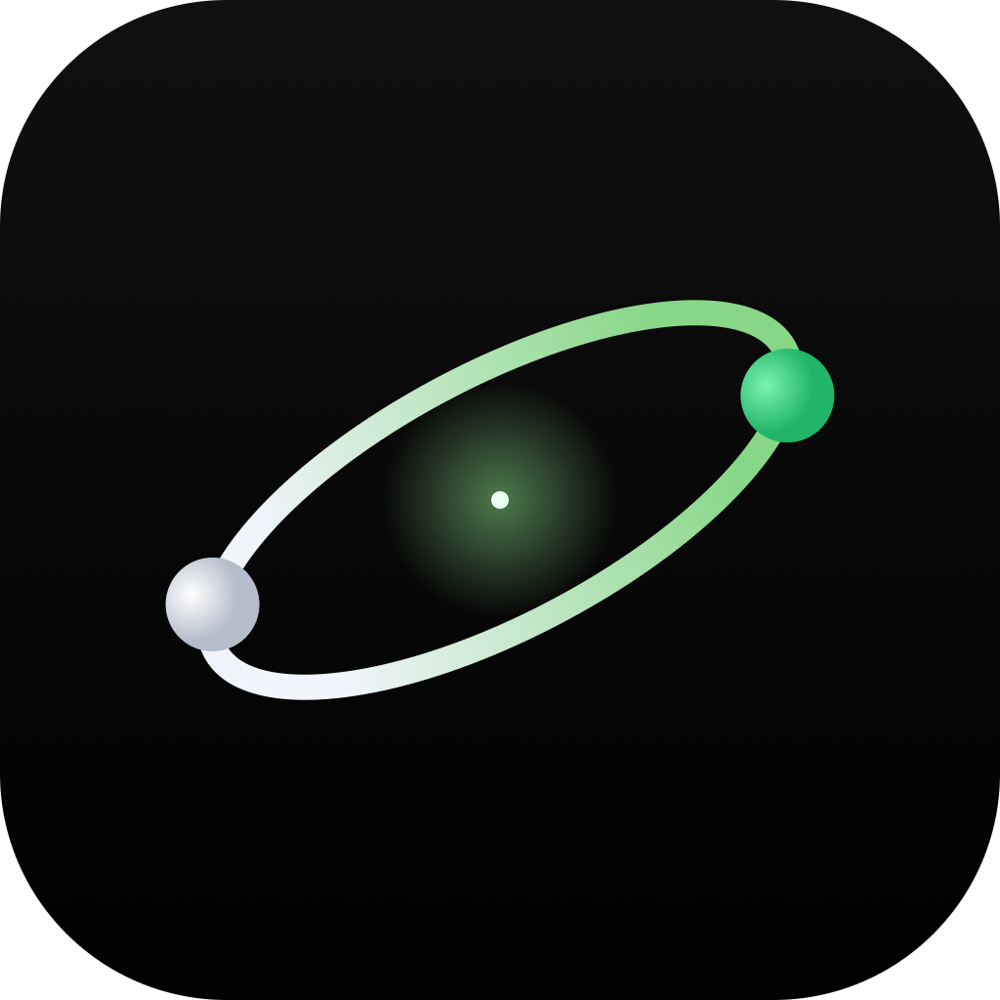
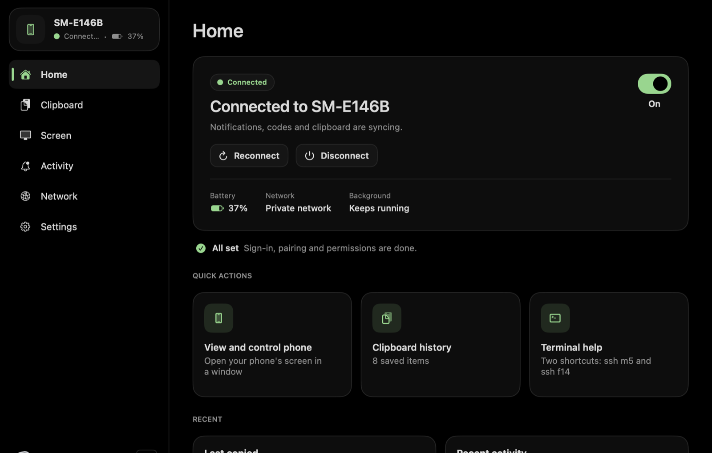
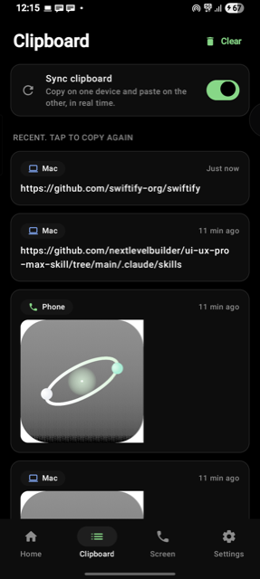
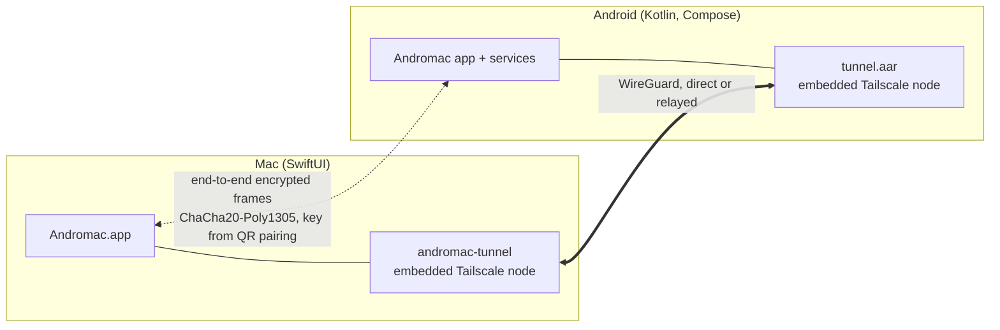

<div align="center">



# Andromac

### Your Mac and your Android phone. One ecosystem. From anywhere.

Notifications, one-time codes, clipboard (text, links **and images**), screen view and control in **both** directions, and terminal shortcuts between a Mac and an Android phone. No cable, no shared Wi-Fi, and **no separate Tailscale app**.




</div>

---

## Why you'll want it

Apple's Continuity is magic, until your phone is a Samsung. KDE Connect is great, until you are not on the same Wi-Fi. Andromac keeps your phone and your Mac in one private, encrypted network, so everything just follows you around.

| | |
|---|---|
| 🔔 **Notifications both ways** | Phone notifications appear on the Mac with the real app's name and icon, with **Reply** and **click to open that conversation on the phone**. Mac notifications show up on the phone too. |
| 🔑 **One-time codes, instantly** | Codes from SMS and notifications are copied to your Mac clipboard the moment they arrive. |
| 📋 **A clipboard that follows you** | Copy text, a link or an **image** on one device and paste it on the other. Each device keeps a searchable history (100 items) and the two histories are swapped every time they connect, even for things copied while offline. |
| 🖥️ **Screen, both directions** | See and control your **phone from the Mac** (trackpad gestures: two-finger scroll, pinch, three-finger drag, rotate) and your **Mac from the phone** (a real touchpad: tap, scroll, pinch, 3-finger drag, 4-finger Spaces and Mission Control, plus a Mac keyboard row). You approve every session. |
| 💻 **Terminal shortcuts** | `ssh m5` from Termux reaches your Mac and `ssh f14` from the Mac reaches your phone, through Andromac, with no VPN app on the phone and sessions that survive Wi-Fi to mobile-data switches. |
| 🌐 **Its own private network** | Andromac embeds [Tailscale's `tsnet`](https://tailscale.com/kb/1244/tsnet) on both devices. Sign in once with a free Tailscale account. No cable, no port forwarding, no cloud server of ours. |
| 🧩 **Always there, never in the way** | It runs in the background as a service on both devices, with a master switch, a **Reconnect** button and **Disconnect** button, and it reconnects on its own after sleep, reboots or network changes. |
| 🧰 **Controls where you need them** | Android: home-screen widget, two Quick Settings tiles, Pause and Mac-screen buttons on the notification. Mac: menu bar app, `⌘K` command palette, `⌘1`-`⌘6`. |
| 🛡️ **Payment-app friendly** | Android's accessibility service is switched on only while you control the phone, and the app asks for no overlay permission, so Paytm and banking apps keep working. |

<div align="center">

&nbsp;&nbsp;

</div>

## How it works



- **Two layers of encryption.** Traffic runs inside Tailscale's WireGuard tunnel *and* inside Andromac's own authenticated frames (ChaCha20-Poly1305, key derived from the QR you scanned, replay-protected). The Mac only listens on `127.0.0.1`; nothing is exposed on your LAN.
- **Video** is H.264 (VideoToolbox on the Mac, MediaCodec on Android) with adaptive bitrate and keyframe recovery.
- **No servers of ours.** No accounts, no analytics. See [PRIVACY.md](PRIVACY.md) and the [protocol](docs/PROTOCOL.md).

## Get started

1. **Mac:** download `Andromac-x.y.z.dmg` from [Releases](../../releases), drag to Applications. First launch: right-click → Open (until the app is notarized).
2. **Android:** download the APK from Releases and install it. Play Protect may warn about a sideloaded app that reads notifications: choose *More details → Install anyway*.
3. **Sign in** to the built-in private network on both devices (same free Tailscale account).
4. **Scan the QR** shown on the Mac with the phone.
5. Follow the **Setup** card to grant permissions. Each *Set up* button opens a guide that names exactly which app to allow and where.
6. Done. Close the windows: Andromac keeps running in the background.

<details>
<summary><b>Controlling the phone from the Mac (and payment apps)</b></summary>

Controlling the phone needs Android's accessibility service. Payment apps such as Paytm refuse to run while such a service is on, so Andromac keeps it **off** and uses it only during a session.

- Turn Andromac on in *Settings → Accessibility → Installed apps* when you want control; Andromac turns itself off again when the session ends.
- Power users: run `adb shell pm grant app.andromac android.permission.WRITE_SECURE_SETTINGS` once and Andromac will switch it on and off by itself.
- Viewing screens, clipboard, notifications, terminal shortcuts and widgets need none of this.
</details>

<details>
<summary><b>Terminal shortcuts</b></summary>

Turn on *Remote Login* on the Mac (System Settings → General → Sharing), keep *Terminal access* on in Andromac, then in Termux:

```
Host m5
  HostName 127.0.0.1
  Port 2222
  User <your Mac username>
```

and `ssh m5`. For the other direction, run Termux's `sshd` and use `Port 2223` on `127.0.0.1` from the Mac.
</details>

## Build from source

Needs Xcode 15+, JDK 17, the Android SDK/NDK and Go.

```bash
# 1. the embedded network node
cd tunnel
go build -o build/andromac-tunnel ./cmd/andromac-tunnel                       # Mac helper
gomobile bind -target=android/arm64 -androidapi 28 -javapkg=app.andromac \
  -o build/tunnel.aar ./mobile && cp build/tunnel.aar ../android/app/libs/    # Android library

# 2. the Mac app
cd ../mac && ./build-app.sh --install        # builds, signs and installs /Applications/Andromac.app
./make-dmg.sh                                # optional: styled installer

# 3. the Android app
cd ../android && ./gradlew assembleDebug
```

Repository layout: [`mac/`](mac) SwiftUI app and widgets · [`android/`](android) Compose app · [`tunnel/`](tunnel) Go node for both · [`docs/`](docs) protocol and notes · [`branding/`](branding) logo.

## Honest notes

Andromac is young. It is built and tested by one person on a Samsung Galaxy M14 (Android 15) and macOS 27.

- Android hides the clipboard from background apps, so phone → Mac clipboard syncs what the system allows; Mac → phone is fully automatic.
- macOS always shows the sending app's icon (Andromac) on the left of native notifications; Andromac attaches the real app icon as a thumbnail and can also draw its own banners.
- Mac widgets and a notarized installer need an Apple Developer ID; see [`mac/Widgets/README.md`](mac/Widgets/README.md) and [`docs/PUBLIC_RELEASE_CHECKLIST.md`](docs/PUBLIC_RELEASE_CHECKLIST.md).
- Fingerprint/Touch ID unlock between the devices is on the roadmap, not built.

## Roadmap

- [ ] Phone fingerprint → unlock the Mac, Touch ID as a gate for phone control
- [ ] Notarized Mac build and the Mac Control Center widget
- [ ] File drag and drop between the devices
- [ ] Reply to SMS and calls from the Mac

## Contributing

Issues and pull requests are welcome. The protocol is documented in [`docs/PROTOCOL.md`](docs/PROTOCOL.md) so other platforms can join the party.

---

<div align="center">

**Made with ♥ by Abhishek Roy**

*"Android" and "Mac" are trademarks of their respective owners. Andromac is an independent project.*

</div>
